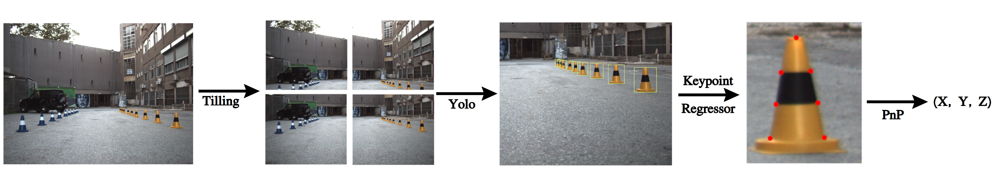
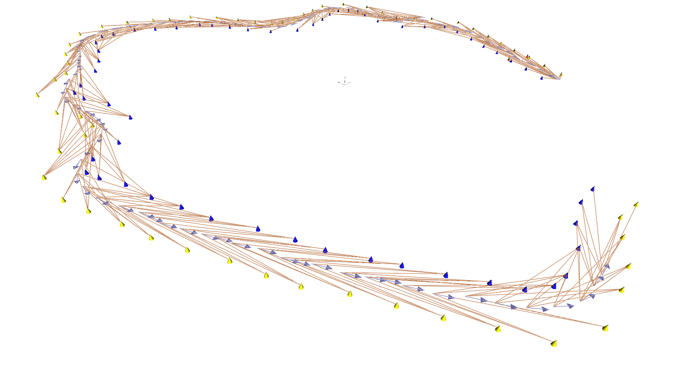
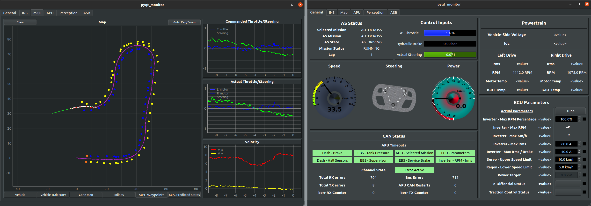

import pushHerToTheLimits from "./push_her_to_the_limits.mp4";

In 2021, I was head of autonomous software at Aristurtle, where we competed in Formula Student East in the driverless category. We got 4th, 3rd, 4th and 4th place in acceleration, skidpad, autocross and trackdrive events respectively. I randomly decided to talk about it today.

(For those unfamiliar with formula student, see a video of FSG driverless [here](https://www.youtube.com/watch?v=2rc50mJ0LBI) and the competition ruleset [here](https://www.formulastudent.de/fsg/rules))

For a long time I didn't consider this worthy of a blog post. We were fairly proud that we completed all driving events and it will be a lifelong memory. But there was nothing immediately striking as novel about our system and we didn't achieve much of the top spots in the competition. However, as I progressed through my engineering career and met more and more engineers from all over the world, I realized that my experience developing our autonomous system was very different than others, which led to many interesting conversations. For the purposes of having something to point to, or hopefully help formula student teams that can relate to us, I decided to write about my experience.

Even when given the same problems, engineers come up with very different strategies based on external circumstances that turn out to have just as important impact as the problem constraints themselves. For us, I recognise 3 external challengies that are unusual to bigger teams:

1. No budget. All autonomous component systems have to come from sponsorships. All costs including R&D came up to about 12k euros. This is compounded by the fact that (especially at the time) there was no high-tech industry in northern Greece which gives little motivation to companies to do sponsored promotions (Huge thanks to those that still helped us!!! I am still referencing your brand at any opportunity).
2. Low number of team members, 5 to be exact (with part time help from the electric vehicle team). This is for the entire car, so in practise for the autonomous system software a manpower of on average ~3 was available for the coding of the entire system.
3. Lack of knowledge. As a newly independently formed driverless team, we did not have any connections to the (anyways scarce) experienced university faculty or PhD students for consulting.

# Design

## Environment perception

The tight budget puts us outside the reach of any high end, dense beam lidars (which you need if you do 10+ m perception), which leaves cameras as the only practical choice. Thankfully, cameras are more than good enough for formula student. With two 45° HFoV 2560x2048 cameras we were able to secure more than 15m perception range, although if I could I would add one more to be more safe on the total available HFoV. For formula student, it is important to pay attention to the details of the perception hardware to ensure precision in high velocities:

- Global shutter with fixed and automatic exposure setting
- Sensor large enough to allow large depth-of-field aperture setting
- Focus configurable or fixed at plane that allows crisp pictures at long range

Our software pipeline is a (then) typical detection - keypoint regression - PnP object position tracking algorithm. It worked fairly well and is fast when optimized on hardware. The only point of caution is that the RektNet keypoint regressor used (https://github.com/cv-core/MIT-Driverless-CV-TrainingInfra) was fairly biased on accurate bounding boxes, so we had to do a little tiling hack on our detection input to up the bounding box accuracy, as well as posttrain with our own extra data.

_Camera pipeline stages: tiling, YOLOv4-tiny cone detection, keypoint regression and PnP for the 3D cone position_

## Path planning & Control

Here is admittedly the hardest part of the competition in terms of the autonomous system. For perception, reaching a good enough level is satisfactory, but after that is secured, your control system decides your finishing time at the dynamic events. An ideal setup uses some form of optimization of track progress per time unit such as an analytic or sampling based MPC solver. There are a few large challenges in accomplishing this

- From the inverter commands to the wheel tractions, there are many parameters that are hard to pinpoint. For example the Z moment of inertia of the car. Now I know that you would fit those parameters from real data anyway (with little regard to realistic values), but that still assumes you have enough representative data of car behavior. And even then, the parameters of a racecar change drastically due to e.g. suspension tuning, tire pressure etc.
- Even if you know all static parameters of the vehicle perfectly, a very significant portion of its behavior (at medium-high speeds) comes from completely runtime factors. Tire temperature, road surface, wind, rain can play a dominant role in how the car moves over time and it is very hard to anticipate as values.

Now I cannot say it is impossible to go with the modeled/optimization route. MPC methods do not necessarily require perfect dynamic modeling and there are ways to deal with runtime parameter adaptation to an extent. But the implementation complexity and required test track hours for the method to reach a beneficial stage was out of our budget.

Instead, we went for the simple pure pursuit with dynamic lookahead point steering control + PID velocity control. Both are very straightforward to tune having 3 or 4 highly relevant parameters, which gave us a very good idea on how to tune the controller after seeing the competition track. It worked out okay for us up to 35kmh, althout higher velocities was also made difficult by the rear-only braking causing the car to drift when decelerating too fast on turns. So I am not sure if that was the bottleneck. For path planning, delauney triangulation of the boundary cones + linearly interpolating a path over the track middle points never betrayed us.

## Vehicle state estimation and mapping

The two earlier systems can be enough if you have long range and wide HFoV enough perception, but in most cases you can benefit you control system by fusing information between multiple perception frames into some form of a local or global map. Especially in our case of narrow perception HFoV, mapping was necessary for the trackdrive, autocross and skidpad events.

For the state of our vehicles, we had hall effect sensors for wheel speed measurement and managed to source quite a good INS with a single GNSS antenna. After fusion with an EKF, this gave us a good enough velocity to place the perceived environment at a common reference over time and we could add graph optimization to refine the cone estimates (to a not well known extent). After completing a full lap however, the velocity estimate is not good enough for the map to close the loop and needs to be reset. You can mitigate this if you come up with good and robust loop closure detection constraints, but we didn't have the manpower to develop and tune this.

_Cool visualization of our SLAM graph: Our cone graph vertices actually embed the cone class besides the position so we do not need a post association step for cone colors. Custom edge and vertex API on g2o made this quite easy._

Besides, developing trustworthy loop closure constraints and graph optimization validation implicitly requires real data ground truth of the track, which is a lot more challenging compared to e.g. ground truth for evaluating perception. In order to do this the solid way you would need to measure the position of all cones with surveyor equipment. But due to the budget team curse, we don't have the university connections to collab with civil engineers, nor the budget to request 3rd party help and definitely not the manpower to train a person how to use a theodolite.

## Telemetry & Datalogging

While not crucial to the mission, it is impossible to develop the above without a friction-free telemetry & datalogging system. ROS did a lot of the heavy lifting here in our case. By implementing monitors for crucial processes, CPU health, GPU health, CAN bus values etc as ROS nodes we were able to very quickly debug issues on the field. Datalogging is just a matter of recordin a rosbag (with the exception of camera videos being independently recorded) and ROS gives us telemetry for free via multicast (within WiFi range).

At our base stations, we were running a mixture of rviz2 and plotjuggler with custom layouts, as well as a custom developed dashboard for easy monitor/setting of various critical health signals of the car.

_Custom car monitor. I couldn't find our year's version so this is the 2022 one (imagine a more primitive version of this). Left: Cone map, vehicle trajectory and control signals. Right: AS state, CAN bus health and tunable ECU parameters_

## Simulation

Simulation will not drive the real car on the track, so from the start simulation is something to be developed up until the needs at hand and not much further. In practise, most of the time simulation is only useful for fast/automated integration tests of the developed system and even then, it gets largely displaced when you get the opportunity to iterate tests on real data. Simulation becomes important only in cases where you have enough confidence in the modeling of your system for a simulation trained RL algorithm to transfer to the real-world, while at the same time not enough real data. Therefore we can get away with a bare minimum Gazebo simulation whose only premise is to mirror the API of the real car (perception, control) so that the autonomous system can be tested as is. This was more than enough, and in fact I think we could get away with even more lightweight for the sake of faster test iteration.

## Final Product

Putting all of the above together, we get something like this

<video
	src={pushHerToTheLimits}
	autoplay
	loop
	muted
	playsinline
	controls
	preload="metadata"
	style={{ width: "100%" }}
/>

## Thanks

To our autonomous sytem sponsors:

- **Festo** - For the excellent quality pneumatics powering our emergency brake system and keeping us and equipment safe on the track.
- **JAI** - For our cameras. Excellent USB GeniCam support and quality sensors as advertised. Optional external power supply and trigger make integration a breeze
- **Navitar** - For the lens. Anything that a demanding precision application will need: Low distortion/aberation, precisely variable focus with lock ring, interchangable aperture.
- **SBG** - For the accurate and easy to use MEMS INS. It became our state estimation sensor we relied most on
- **Cincoze** - For the DS1202 that never throttled while full load at direct Greek summer sunlight

And of course credits go to my OP teammates for making this possible: Nikos Kotarelas, Dimosthenis Natsos, Anastasis Grammenos and Dimitris Fotiou. Thanks to EV team for helping and putting up with us as well :)
